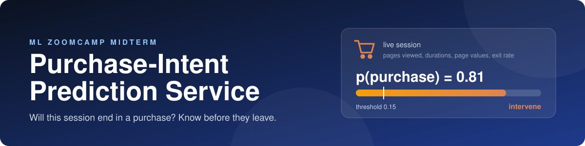
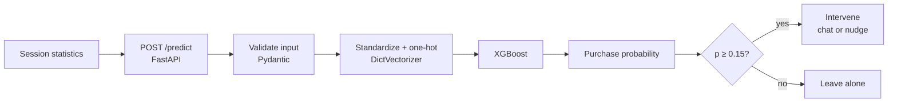

# Purchase-Intent Prediction Service

<p align="center">
  
</p>

<p align="center">
  
  
  
  
  
  
  
  
  
</p>

**ML Zoomcamp midterm project.** An online shop wants to know, *while a visitor is still
browsing*, whether the session is likely to end in a purchase. This project trains a binary
classifier that scores each session with a purchase probability and serves it as a web API.
Sessions scoring above a business threshold trigger an intervention (a proactive chat invite or a
small nudge such as free shipping); everyone else is left alone.

The full problem framing is in [`project-info/business-case.md`](project-info/business-case.md).

## Quick start

```bash
uv sync                                  # create .venv from the lockfile
source .venv/bin/activate                # activate it (or prefix commands with `uv run`)
uv run python train.py                   # optional: re-train and re-create model.bin
uv run uvicorn predict:app --port 9696   # serve the API
```

Or with Docker (the image uses the committed `model.bin`):

```bash
docker build -t purchase-intent-predictor .
docker run -it --rm -p 9696:9696 purchase-intent-predictor
```

Then open <http://localhost:9696/docs> for interactive API docs, or use the `curl` example below.

## How it works



## Results

| Model | Default AUC | Tuned AUC | Tuned parameters |
|---|---|---|---|
| Logistic regression | 0.8913 | 0.8920 | `C=0.01` |
| Decision tree | 0.7367 | 0.9202 | `max_depth=5, min_samples_leaf=100` |
| Random forest | 0.9243 | 0.9288 | `n_estimators=200, max_depth=20, min_samples_leaf=3` |
| **XGBoost (shipped)** | 0.9253 | **0.9350 ± 0.0037** | `n_estimators=100, eta=0.05, max_depth=4, min_child_weight=10` |

All scores are ROC AUC from stratified 5-fold CV on the 80% training split (seed 42).

- **Final model:** XGBoost retrained on the full 80%, with **test AUC 0.9322** from a single
  check. That is 0.0028 below the CV estimate, so there is no sign of leakage or overfitting. The
  tuned CV score is mildly optimistic because the parameters were selected on the same folds, so
  the test score is the honest estimate.
- **Threshold = 0.15**, chosen from business costs on out-of-fold predictions: a wasted
  intervention costs 1 and a lost sale costs 5 (FN:FP = 5:1). On the test set this gives
  **precision 0.520 and recall 0.864**, about 258 interventions per 1,000 sessions.
  Sensitivity (out-of-fold): a 1:1 cost ratio gives threshold 0.50 (precision 0.742), 3:1 gives
  0.25 (precision 0.602), and 10:1 gives 0.10 (precision 0.467). If agent capacity caps
  interventions below about 25% of sessions, move toward the 3:1 setting.
- **The headline result depends on `pagevalues`.** The shipped model scores 0.9350 CV / 0.9322
  test **with** `pagevalues`, but only **0.7819** without it. The rule fixed in advance was to
  ship without it if the best model without it held AUC ≥ 0.85. That failed (the best was 0.786,
  random forest, and every model fell to 0.75 to 0.79), so **the model ships with
  `pagevalues`**. It is a Google Analytics metric defined around completed transactions, which
  the business case flags as questionable for mid-session scoring. If the shop cannot compute it
  incrementally during a live session, expect performance near 0.78, not 0.93. The full
  comparison is in notebook section 12.
- **Class weights** (`class_weight='balanced'` / `scale_pos_weight`) were tested and *not* kept.
  The decision rule applies to the shipped model, and on the final XGBoost the gain was +0.0002
  (noise; logistic regression gained +0.0055, but it is not the model we deploy). The 15.5%
  class imbalance is handled by stratified splits and CV and by the cost-based threshold (see
  [`project-info/class-imbalance-note.md`](project-info/class-imbalance-note.md)).

## Dataset

[Online Shoppers Purchasing Intention Dataset](https://archive.ics.uci.edu/dataset/468/online+shoppers+purchasing+intention+dataset),
UCI Machine Learning Repository, DOI [10.24432/C5F88Q](https://doi.org/10.24432/C5F88Q)
(Sakar, C. & Kastro, Y., 2018). 12,330 sessions, 18 attributes, 15.5% positives.
Licensed **CC BY 4.0**, so the CSV is committed at
[`data/online_shoppers_intention.csv`](data/online_shoppers_intention.csv) and no download step
is needed. Details and citation: [`project-info/dataset-info.md`](project-info/dataset-info.md).

## Repository layout

```
├── README.md                  <- this file
├── assets/banner.svg          <- README banner
├── notebook.ipynb             <- full EDA + model selection (executed top to bottom)
├── train.py                   <- trains the final model, saves model.bin
├── predict.py                 <- FastAPI service
├── tests/                     <- pytest suite (API, cleaning, training)
├── Dockerfile
├── pyproject.toml / uv.lock   <- reproducible environment (uv)
├── data/online_shoppers_intention.csv
├── project-info/              <- business case, plan, dataset notes
└── model.bin                  <- trained model (committed, about 160 KB; train.py recreates it)
```

## Setup

Requires [uv](https://docs.astral.sh/uv/) and Python 3.13 (uv finds or downloads a matching
interpreter). Docker is only needed for the container.

```bash
uv sync                    # creates .venv from uv.lock, including the dev tools (Jupyter, pytest)
source .venv/bin/activate  # activate the environment
```

For an install without the dev tools, use `uv sync --no-dev`.

## Training

```bash
uv run python train.py
```

Expected output:

```
model: xgboost {'n_estimators': 100, 'learning_rate': 0.05, 'max_depth': 4, 'min_child_weight': 10}
test ROC AUC:              0.9322   (notebook CV estimate: 0.9350)
at threshold 0.15:
  precision 0.520   recall 0.864
  tp=330, fp=305, fn=52, tn=1779
saved model.bin
```

The cleaning, feature encoding, split seed and parameters are identical to the notebook. The
notebook (`notebook.ipynb`) contains the EDA, model comparison, tuning and threshold analysis.
The pickled model depends on library versions, so retrain with `uv run python train.py` if you
change the environment.

## Running the service locally

```bash
uv run uvicorn predict:app --host 0.0.0.0 --port 9696
```

Test it in another terminal:

```bash
curl -X POST http://localhost:9696/predict \
  -H 'Content-Type: application/json' \
  -d '{
    "administrative": 2, "administrative_duration": 120.0,
    "informational": 1, "informational_duration": 30.0,
    "productrelated": 40, "productrelated_duration": 1800.0,
    "bouncerates": 0.0, "exitrates": 0.02,
    "pagevalues": 25.0, "specialday": 0.0,
    "month": "nov", "operatingsystems": 2, "browser": 2,
    "region": 1, "traffictype": 2,
    "visitortype": "new_visitor", "weekend": false
  }'
```

Response:

```json
{"purchase_probability": 0.8138, "purchase": true, "threshold": 0.15}
```

### API reference

| Method | Path | Purpose |
|---|---|---|
| `GET` | `/health` | Returns `{"status": "ok"}` |
| `POST` | `/predict` | Scores one session and returns the probability and the decision |
| `GET` | `/docs` | Interactive Swagger documentation |

Input validation mirrors the dataset. Values must be lowercase and standardized, so the raw CSV
values `Nov` or `Returning_Visitor` are rejected with a `422`.

| Field | Accepted values |
|---|---|
| `month` | `feb mar may jun jul aug sep oct nov dec` (`jan` and `apr` never occur in the data) |
| `visitortype` | `returning_visitor`, `new_visitor`, `other` |
| `operatingsystems`, `browser`, `region`, `traffictype` | integer codes: 1 to 8, 1 to 13, 1 to 9, 1 to 20 |
| `bouncerates`, `exitrates`, `specialday` | numbers between 0 and 1 |
| counts and durations | numbers of 0 or more |
| `weekend` | `true` or `false` |

## Docker

`model.bin` is committed, so the image builds directly from a fresh clone:

```bash
docker build -t purchase-intent-predictor .
docker run -it --rm -p 9696:9696 purchase-intent-predictor
```

Then send the same `curl` request as above. The image installs dependencies from the frozen
`uv.lock` (no dev dependencies) and starts uvicorn on `0.0.0.0:9696`. If you retrain, run
`uv run python train.py` before rebuilding so the image picks up the new `model.bin`.

## Tests

```bash
uv run pytest
```

The suite (25 tests, a few seconds) covers:

- **API (`tests/test_predict.py`):** health check, response shape, probabilities in [0, 1],
  the threshold decision, rejection of invalid or missing input, and a check that the API's
  probabilities match running the model directly on cleaned data.
- **Training (`tests/test_train.py`):** the cleaning rules (lowercase names and values,
  `june` → `jun`, codes as strings, bools as ints), that the target never enters the features,
  and an end-to-end run of `train.py` that checks the saved artifact.
- **Shipped model (`tests/test_shipped_model.py`):** a smoke test of the real `model.bin`,
  skipped when the file is absent.

The API tests use a small throwaway model trained on the committed dataset, so they do not
depend on `model.bin`. `predict.py` reads the model path from the `MODEL_PATH` environment
variable (default `model.bin`), which is how the tests point it at that model.

## Reproducibility notes

- Fixed seed 42 everywhere (split, CV folds, models).
- Preprocessing (one-hot encoding) is fitted per CV fold inside the notebook and saved together
  with the model in `model.bin`, so the service applies exactly the training transforms.
- Column and value standardization (lowercase, spaces → underscores, `june` → `jun`, code
  columns → strings) is identical in `notebook.ipynb`, `train.py` and `predict.py`, and the tests
  check that the API agrees with the training pipeline.
- The dataset CSV is committed (CC BY 4.0 permits redistribution with credit).

## Limitations

- The model predicts who *buys*, not who would be *persuaded* by an intervention. Measuring the
  real effect needs an A/B test (see `project-info/business-case.md`).
- `pagevalues` dominance is an operational risk if the shop cannot compute it mid-session
  (numbers without it are reported in the notebook).
- Data covers one retailer over one year, so performance may differ for other shops or seasons.